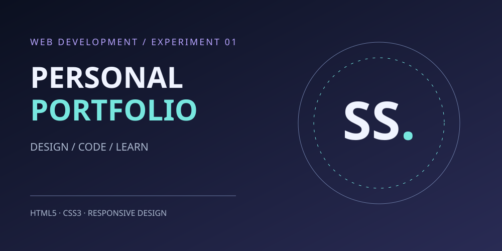

# Personal Portfolio — HTML & CSS



A responsive personal developer profile created as an introductory web-development experiment. The site introduces Shivanshu Satyajeet, describes areas of learning and links to the public GitHub profile.

**Project status:** Academic web-development experiment / implemented static prototype. Browser and public deployment verification pending.

## Features

- Semantic HTML5 page structure, including header, navigation, main and footer
- About, skills and GitHub connection sections
- Responsive CSS Grid and Flexbox layouts
- Modern dark interface with a CSS monogram illustration
- Keyboard-visible focus, skip navigation, readable contrast and reduced-motion support
- Verified repository/profile destinations from the project's GitHub owner; unconfigured social placeholders removed
- No framework, JavaScript, external fonts, API keys or build step

## Run locally

Open `index.html` in a browser or serve the repository root:

```bash
python -m http.server 8000
```

Visit http://localhost:8000.

## Project structure

```text
Exprement-1/
├── assets/
│   └── cover.svg
├── tests/
│   └── check_structure.py
├── index.html
├── style.css
└── README.md
```

## Testing

Run `python tests/check_structure.py` for static checks of page landmarks, navigation targets, stylesheet existence and placeholder links. Manually check the layout at desktop and mobile widths and navigate with the Tab key before publishing.

## Learning objectives

Practice semantic HTML, responsive styling, typography, accessible navigation and publishing a static webpage.

## Deployment

The site can be hosted on a static hosting service. No live URL is documented until verified. This is the original experiment, not a replacement for any separate production portfolio.
